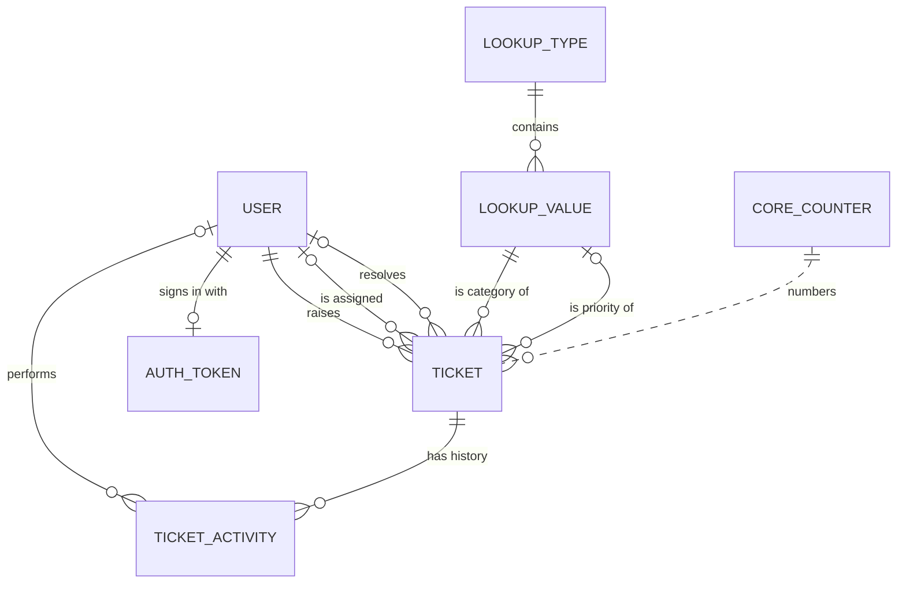
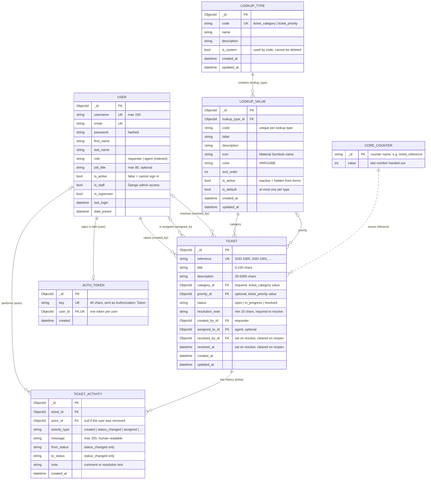
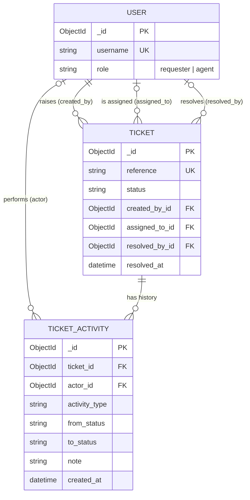
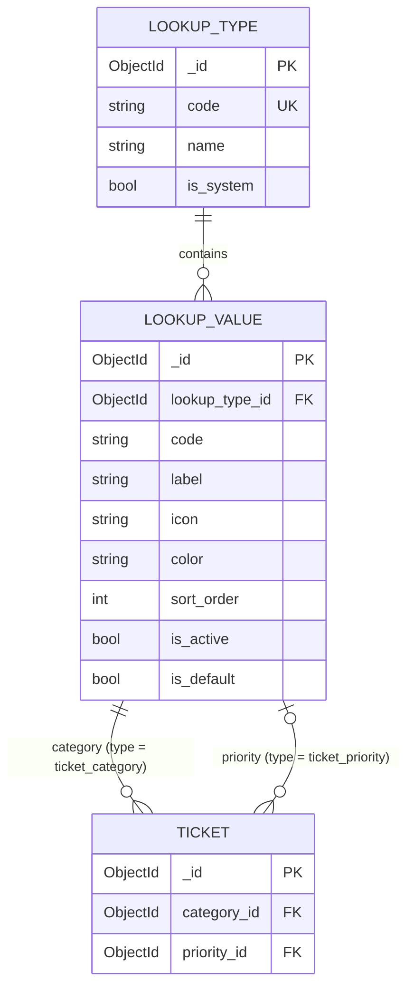
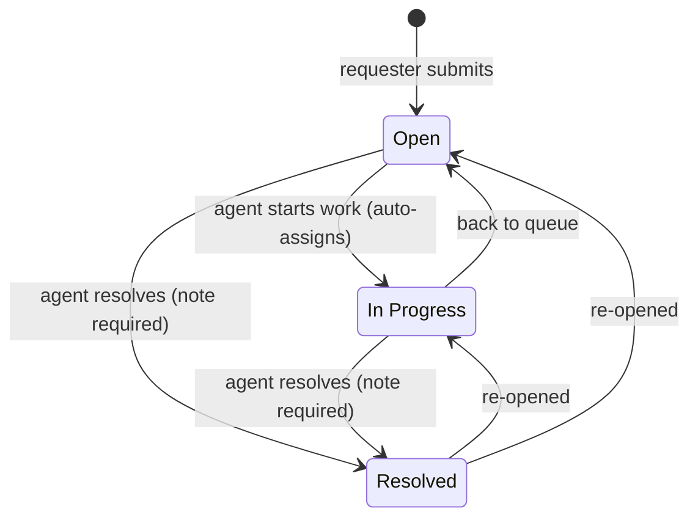

# Data model - ER diagrams

This page describes how the data of Smart Support Desk is organised in MongoDB: which collections exist, which
fields they hold and how they point at each other. The diagrams are written in Mermaid, so they render directly on
GitHub and in VS Code's Markdown preview.

Everything here comes from the Django models:

| App | Models | File |
|---|---|---|
| accounts | `User` | `backend/apps/accounts/models.py` |
| lookups | `LookupType`, `LookupValue` | `backend/apps/lookups/models.py` |
| tickets | `Ticket`, `TicketActivity` | `backend/apps/tickets/models.py` |
| core | `TimeStampedModel` (abstract base), `core_counters` collection | `backend/apps/core/models.py`, `sequences.py` |
| DRF | `Token` (sign-in token) | `rest_framework.authtoken` |

Contents

1. [Overview](#1-overview)
2. [Full ER diagram](#2-full-er-diagram)
3. [Tickets and people](#3-tickets-and-people)
4. [Configurable lists (lookups)](#4-configurable-lists-lookups)
5. [Relationships at a glance](#5-relationships-at-a-glance)
6. [Collections and indexes](#6-collections-and-indexes)
7. [Rules the diagram cannot show](#7-rules-the-diagram-cannot-show)
8. [Ticket lifecycle](#8-ticket-lifecycle)
9. [What a stored document looks like](#9-what-a-stored-document-looks-like)

**How to read the lines**

| Symbol | Meaning |
|---|---|
| `\|\|` | exactly one |
| `\|o` | zero or one (the reference is optional) |
| `o{` | zero or many |
| solid line | a real reference field (an ObjectId stored in the document) |
| dotted line | a logical link with no reference field |

---

## 1. Overview

The big picture without fields. Five collections hold the business data; `core_counters` hands out ticket numbers.



In one sentence each:

- A **user** is either a *requester* or a *support agent* (`role`).
- A **ticket** is raised by one requester, may be assigned to one agent and, once resolved, records who resolved it.
- Every change to a ticket writes a **ticket activity** row - the audit trail and comment thread.
- **Lookup types** and **lookup values** are the configurable lists (categories, priorities) that the UI is built from.
- A ticket's **category** and **priority** are lookup values.
- The **counter** document gives every new ticket its `SSD-xxxx` reference.

---

## 2. Full ER diagram

Every stored field. `created_at` / `updated_at` come from the shared `TimeStampedModel` base class.



---

## 3. Tickets and people

The same user collection plays three different parts on a ticket, so `Ticket` has three separate references to
`User`. A fourth reference lives on each activity row (who did it).



| Reference | Who it points at | When it is filled |
|---|---|---|
| `Ticket.created_by` | the requester (or agent) who raised the ticket | always, at creation |
| `Ticket.assigned_to` | the support agent working on it | when an agent assigns it, or automatically when an agent clicks *Start progress* on an unassigned ticket |
| `Ticket.resolved_by` | the agent who moved it to *Resolved* | on resolve; cleared again if the ticket is re-opened |
| `TicketActivity.actor` | whoever made the change or wrote the comment | on every activity row |

`TicketActivity` is append-only. Comments are stored here too (`activity_type = commented`, text in `note`), which is
why there is no separate comments collection. Keeping the history in its own collection, instead of embedding it in
the ticket, lets the *Activity log* screen search, sort and export it across all tickets.

Activity types (`apps/tickets/constants.py → ActivityType`):

| `activity_type` | Written when | Extra fields used |
|---|---|---|
| `created` | a ticket is raised | - |
| `status_changed` | the status moves | `from_status`, `to_status`, `note` (the resolution note when resolving) |
| `assigned` | the assignee changes | - |
| `resolution_updated` | the note of an already resolved ticket is edited | `note` |
| `details_updated` | category or priority changes | - |
| `commented` | someone adds a comment | `note` |

---

## 4. Configurable lists (lookups)

Categories and priorities are not hard-coded anywhere. They are rows in two collections that follow the
"master data" pattern: `LookupType` names a kind of list, `LookupValue` holds its options.



Both ticket references point at the same `LookupValue` collection. What keeps a priority out of the category field
is the lookup type: the model limits `category` to values of type `ticket_category` and `priority` to values of type
`ticket_priority`, and the API serializer additionally rejects inactive values.

Rows created by the migration `apps/lookups/migrations/0002_default_lookups.py`:

| Lookup type (`code`) | Values (`code`) | Default |
|---|---|---|
| `ticket_category` | `login_access`, `billing`, `bug`, `performance`, `integration`, `account`, `data_reports`, `feature_request`, `other` | - |
| `ticket_priority` | `low`, `medium`, `high`, `critical` | `medium` |

They can be renamed, re-ordered, re-coloured, deactivated or extended from the *Configuration* screen or the Django
admin without touching code. Adding a brand-new kind of list only needs a new `LookupType` row plus a reference from
whichever model uses it.

---

## 5. Relationships at a glance

| From | Field | To | Cardinality | Required | On delete of the target | Reverse name |
|---|---|---|---|---|---|---|
| Ticket | `created_by` | User | many → one | yes | **PROTECT** - blocked | `tickets_created` |
| Ticket | `assigned_to` | User | many → zero/one | no | SET NULL | `tickets_assigned` |
| Ticket | `resolved_by` | User | many → zero/one | no | SET NULL | `tickets_resolved` |
| Ticket | `category` | LookupValue | many → one | yes | **PROTECT** - blocked | `category_tickets` |
| Ticket | `priority` | LookupValue | many → zero/one | no | **PROTECT** - blocked | `priority_tickets` |
| TicketActivity | `ticket` | Ticket | many → one | yes | CASCADE - history removed with the ticket | `activities` |
| TicketActivity | `actor` | User | many → zero/one | no | SET NULL | `ticket_activities` |
| LookupValue | `lookup_type` | LookupType | many → one | yes | **PROTECT** - blocked | `values` |
| Token | `user` | User | one → one | yes | CASCADE | `auth_token` |

What PROTECT means in practice: a user who has raised tickets, or a category/priority that tickets use, cannot be
deleted. Deactivate them instead (`User.is_active = False`, `LookupValue.is_active = False`) - they disappear from
sign-in and forms while old tickets keep their history intact.

MongoDB has no foreign keys of its own. Django stores each reference as an ObjectId field (`category_id`,
`created_by_id`, ...) and enforces the delete rules above in Python. When a query needs the related document, the
Django MongoDB Backend joins with a `$lookup` stage.

---

## 6. Collections and indexes

Collection names follow Django's `<app>_<model>` convention. Indexes are declared on the models and created by
`python manage.py migrate`.

| Model | Collection | Indexes (besides `_id`) |
|---|---|---|
| User | `accounts_user` | `username` unique, `email` unique, `role` |
| Token | `authtoken_token` | `key` unique, `user_id` unique |
| Ticket | `tickets_ticket` | `reference` unique, `status`, `created_at`, `category_id`, `priority_id`, `created_by_id`, `assigned_to_id`, `resolved_by_id`, **`ticket_status_created_idx`** (`status`, `created_at` desc), **`ticket_owner_created_idx`** (`created_by_id`, `created_at` desc) |
| TicketActivity | `tickets_ticketactivity` | `ticket_id`, `actor_id`, `activity_type`, `created_at` |
| LookupType | `lookups_lookuptype` | `code` unique, `created_at` |
| LookupValue | `lookups_lookupvalue` | `lookup_type_id`, `created_at`, **`unique_lookup_value_code`** (`lookup_type_id`, `code`) unique |
| - | `core_counters` | `_id` is the counter name |

The two compound ticket indexes match the two most common screens: the agent queue filtered by status and sorted
newest first, and a requester's *My tickets* list sorted newest first.

Django's own framework collections (`auth_group`, `auth_permission`, `accounts_user_groups`,
`accounts_user_user_permissions`, `django_content_type`, `django_session`, `django_admin_log`, `django_migrations`)
are also present because the Django admin uses them. The application itself does not rely on groups or
per-user permissions - access is decided by `User.role` - so they are left out of the diagrams.

---

## 7. Rules the diagram cannot show

| Rule | Where it is enforced |
|---|---|
| `Ticket.category` must be an active value of type `ticket_category`; `Ticket.priority` of type `ticket_priority` | `limit_choices_to` on the model + `TicketCreateSerializer` / update serializer |
| A lookup value `code` is unique within its type, lowercase letters, digits and `_` only | `UniqueConstraint` + regex validator on `LookupValue` |
| Colours are `#RRGGBB` | regex validator on `LookupValue.color` |
| At most one `is_default = True` value per lookup type | `LookupValue.save()` clears the flag on the others |
| `Ticket.reference` is unique and gap-free (`SSD-1000`, `SSD-1001`, ...) | `apps/core/sequences.py` - atomic `findOneAndUpdate` + `$inc` on `core_counters`; prefix from `.env`, start number in `settings.py` |
| Title 5-150 chars, description 20-5000, resolution note at least 10 | `apps/tickets/constants.py` (served to the UI via `/api/config/`) |
| A ticket can only be *Resolved* with a resolution note | `apps/tickets/services.py` |
| Only the allowed status moves are accepted | `STATUS_TRANSITIONS` in `apps/tickets/constants.py` |
| `resolved_by` / `resolved_at` are set on resolve and cleared on re-open | `apps/tickets/services.py` |
| Requesters only see tickets where `created_by` is themselves | queryset filtering in `apps/tickets/views.py` |
| Activity rows are never edited or deleted (except with their ticket) | no update/delete endpoints for activities |

---

## 8. Ticket lifecycle

The values of `Ticket.status` and the moves allowed between them.



| Move | Activity rows written | Fields changed on the ticket |
|---|---|---|
| submit | `created` | all fields; `reference` from the counter |
| Open → In Progress | `status_changed`, plus `assigned` if it was unassigned | `status`, `assigned_to` |
| → Resolved | `status_changed` (resolution text copied into `note`) | `status`, `resolution_note`, `resolved_by`, `resolved_at` |
| Resolved → Open / In Progress | `status_changed` | `status`; `resolved_by` and `resolved_at` cleared |
| back to queue | `status_changed` | `status` |

Each status change also e-mails the requester (`apps/tickets/notifications.py`).

---

## 9. What a stored document looks like

A resolved ticket in `tickets_ticket` (ObjectIds shortened). References are plain ObjectId fields - nothing is
embedded.

```js
{
  "_id": ObjectId("6afca3a2...65b1"),
  "reference": "SSD-1000",
  "title": "Cannot log in after resetting my password",
  "description": "I reset my password using the 'Forgot password' link ...",
  "category_id": ObjectId("6afc905d...1e98"),
  "priority_id": ObjectId("6afc905d...1ea4"),
  "status": "resolved",
  "resolution_note": "The account was locked after five failed attempts ...",
  "created_by_id": ObjectId("6afc90c5...cc23"),
  "assigned_to_id": ObjectId("6afc90c6...cc27"),
  "resolved_by_id": ObjectId("6afc90c6...cc27"),
  "resolved_at": ISODate("2026-10-08T19:56:38Z"),
  "created_at": ISODate("2026-10-07T17:56:38Z"),
  "updated_at": ISODate("2026-10-08T19:56:38Z")
}
```

One of its rows in `tickets_ticketactivity`:

```js
{
  "_id": ObjectId("6afca3a2...65b4"),
  "ticket_id": ObjectId("6afca3a2...65b1"),
  "actor_id": ObjectId("6afc90c6...cc27"),
  "activity_type": "status_changed",
  "message": "Status changed from Open to In Progress",
  "from_status": "open",
  "to_status": "in_progress",
  "note": "",
  "created_at": ISODate("2026-10-08T11:26:38Z")
}
```

And the counter that numbered it, in `core_counters`:

```js
{ "_id": "ticket_reference", "value": 1027 }
```

To explore the real data, open MongoDB Compass → `smart_support_desk` and pick any of the collections above.
