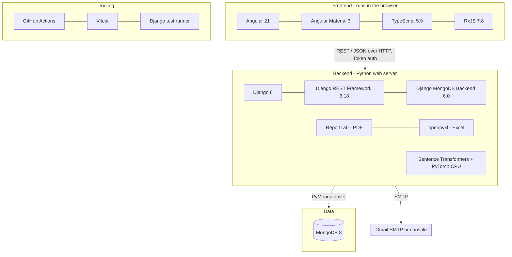

# Technology stack

Every library, tool and service the project uses, with the exact version, what it does here and why it was picked.
Versions come from `backend/requirements.txt`, `frontend/package.json` and `.github/workflows/ci.yml`.

Contents

1. [At a glance](#1-at-a-glance)
2. [Frontend](#2-frontend)
3. [Backend](#3-backend)
4. [Database](#4-database)
5. [AI - similar ticket and category suggestions](#5-ai---similar-ticket-and-category-suggestions)
6. [Exports and e-mail](#6-exports-and-e-mail)
7. [Testing, quality and CI](#7-testing-quality-and-ci)
8. [Security measures](#8-security-measures)
9. [Runtime requirements](#9-runtime-requirements)

---

## 1. At a glance

| Layer | Technology | Version |
|---|---|---|
| UI framework | Angular (standalone components, signals, zoneless) | 21.2 |
| UI components | Angular Material + CDK (Material 3 design) | 21.2 |
| Language (frontend) | TypeScript | 5.9 |
| Reactive streams | RxJS | 7.8 |
| Web framework | Django | 6.0.10 |
| REST API | Django REST Framework | 3.18.3 |
| Database driver / ORM backend | Django MongoDB Backend + PyMongo | 6.0.4 / 4.20.0 |
| Database | MongoDB Community Server (tested on 8.0, works on 6.0+) | 8.0 |
| AI model runtime | Sentence Transformers + Hugging Face Transformers + PyTorch (CPU) | 6.2.0 / 5.22.1 / 2.15.0 |
| AI model | `sentence-transformers/all-MiniLM-L6-v2` (Apache 2.0) | - |
| Numeric computing | NumPy | 2.5.4 |
| PDF export | ReportLab | 5.1.0 |
| Excel export | openpyxl | 3.1.5 |
| Cross-origin requests | django-cors-headers | 4.9.0 |
| Settings from `.env` | python-dotenv | 1.2.4 |
| Frontend unit tests | Vitest (through the Angular CLI) | 4.0 |
| CI/CD | GitHub Actions | - |
| Fonts and icons | Poppins (Google Fonts), Material Symbols Outlined | - |

---

## 2. Frontend

| Technology | Used for | Why |
|---|---|---|
| **Angular 21** | the single-page app: routing, forms, HTTP, every screen | complete framework with a router, forms and HTTP client built in, strict typing, long-term support |
| Standalone components | every component imports what it needs, no `NgModule`s | less boilerplate, each page can be lazy loaded on its own |
| **Signals** (`signal`, `computed`, `effect`) | all screen state: loading flags, table state, the signed-in user, configuration | the screen updates exactly where a value changed; simpler than juggling observables for UI state |
| Zoneless change detection | no `zone.js`; Angular re-renders when a signal changes | smaller bundle and faster rendering |
| New control flow (`@if`, `@for`, `@switch`) | templates | easier to read than `*ngIf` / `*ngFor` |
| Lazy routes (`loadComponent`) | each page is downloaded the first time it is opened | about 140 kB initial transfer |
| Route guards | `authGuard`, `guestGuard`, `agentGuard`, `configGuard` | agents-only pages are blocked in the browser as well as in the API |
| HTTP interceptor | adds `Authorization: Token ...`, sends the user to sign-in on `401` | one place for auth instead of every service |
| Reactive forms | create ticket, manage ticket, comments, sign in / sign up, configuration dialog | validators mirror the API rules, and server errors are mapped back onto the matching field |
| **Angular Material 3** | buttons, form fields, selects, date range picker, dialogs, menus, tooltips, snack bars, progress bars | accessible, keyboard friendly, consistent look; themed with the project's colours in `styles/_material.scss` |
| Angular CDK | `BreakpointObserver` (collapsible sidebar on small screens), key codes for the e-mail chips | used under Material and by the responsive shell |
| **RxJS** | HTTP calls, debounced search, auto-refresh timers | standard Angular tool for async streams |
| SCSS + design tokens | `styles/_tokens.scss` (colours, radius, spacing, font), utilities | one place to change the look |
| Poppins + Material Symbols | typography and icons; icon names also come from the backend for categories and priorities | the backend can choose any of ~3,000 icons without a frontend change |

Reusable building blocks in `frontend/src/app/shared/`:

| Building block | What it does |
|---|---|
| `DataTable` + `TableSource` | one table component for every list: server-side search, sort, filters, paging, empty / loading / error states, silent auto-refresh |
| `ExportMenu` + `EmailExportDialog` | the *Export* button on every table: PDF, Excel, e-mail |
| `StatusBadge`, `LookupBadge`, `UserAvatar` | coloured status chip, category / priority chip with icon, avatar with initials |
| `PageHeader`, `LiveIndicator`, `CountUp`, `ConfirmDialog` | page titles, "Updated 10:42:05 AM" badge, animated dashboard numbers, confirmation dialog |
| `RelativeTimePipe` | "5 minutes ago" with the exact time in a tooltip |

---

## 3. Backend

| Technology | Used for | Why |
|---|---|---|
| **Python 3.12+** (CI uses 3.13) | backend language | Django 6 requires 3.12+ |
| **Django 6** | models, migrations, authentication, password hashing, admin site, e-mail, settings | batteries included: user accounts, admin and validation come for free |
| **Django REST Framework** | the JSON API: viewsets, serializers (validation), token auth, permissions, throttling, pagination, search and ordering filters | the standard way to build REST APIs on Django |
| DRF `TokenAuthentication` | `Authorization: Token <key>` on every API call | simple and stateless for a single-page app |
| DRF `SessionAuthentication` | the browsable API at `/api/` after signing in to the Django admin | handy for exploring the API by hand |
| `ScopedRateThrottle` | rate limits on sign-in / sign-up (`auth`) and similar-ticket searches (`similar`) | protects against password guessing and heavy model use |
| Django admin | manage users and agents, categories, priorities, notification events, tickets | back office without writing screens |
| **django-cors-headers** | lets the Angular dev server (port 4200) call the API (port 8000) | the two run on different origins |
| **python-dotenv** | reads `backend/.env` | configuration without editing code |
| Service layer (`apps/tickets/services.py`) | every business rule: references, transitions, auto-assign, resolution note, activity log, notifications | API, seed command and tests all share the same rules |

Backend apps (`backend/apps/`):

| App | Responsibility |
|---|---|
| `core` | base model with timestamps, ObjectId serializers, one API error format, pagination, atomic counters, MongoDB-aware JSON renderer, e-mail layout, export engine |
| `accounts` | custom `User` with a `role`, login / register / logout / me, demo accounts, user directory, role permissions |
| `lookups` | `LookupType` / `LookupValue`: the configurable lists (categories, priorities, notification events) |
| `tickets` | `Ticket`, `TicketActivity`, workflow rules, notifications, dashboard numbers, `/api/config/`, demo data |
| `similarity` | similar ticket suggestions: model loading, embedding cache, ranking, management commands |

---

## 4. Database

| Technology | Used for | Why |
|---|---|---|
| **MongoDB 8** (Community Server, works on 6.0+) | stores every collection | document database required by the brief; flexible schema |
| **Django MongoDB Backend** (official, by MongoDB) | lets Django's ORM, migrations, admin and auth run on MongoDB | keeps Django's productivity instead of hand-writing queries |
| **PyMongo** | direct `findOneAndUpdate` + `$inc` for the ticket reference counter | an atomic operation that needs no transaction |
| **GridFS** (part of MongoDB, used through PyMongo's `GridFSBucket`) | stores attached files in the `attachments.files` / `attachments.chunks` collections | files live and are backed up with the rest of the data; no separate file server or upload folder |
| MongoDB Compass | browsing the data during development | free GUI from MongoDB |

Collections, fields, indexes and relationships are described in [ER_DIAGRAMS.md](ER_DIAGRAMS.md).

---

## 5. AI - similar ticket and category suggestions

| Technology | Used for | Why |
|---|---|---|
| **`all-MiniLM-L6-v2`** | turns a ticket's title + description into 384 numbers (an embedding) | open source (Apache 2.0), small (~90 MB), fast on a normal CPU, good at short English texts |
| **Sentence Transformers** | loads and runs the model | the standard library for this family of models |
| Hugging Face Transformers | model architecture and tokenizer under Sentence Transformers | dependency of the above |
| **PyTorch (CPU build)** | runs the neural network | no graphics card needed |
| **NumPy** | cosine similarity between the new text and every cached embedding | fast vector maths; MongoDB Community has no vector search |
| TF-IDF keyword matching (own code) | fallback when the model cannot be loaded | the feature keeps working offline |

The same model and cached embeddings power two features:

| Feature | How | Where |
|---|---|---|
| **Similar resolved tickets** | cosine similarity between the draft and every resolved ticket; the best 3 at or above 0.35 | `find_similar()` in `apps/similarity/services.py`, `POST /api/tickets/similar/` |
| **Category suggestion** while typing | the 10 most similar past tickets (score 0.30 or more) vote for their category, weighted by score; suggested when one category has at least half of the vote, otherwise the category descriptions are compared; 96% of suggestions right on the demo data | `suggest_category()` in the same file, `POST /api/tickets/suggest-category/` |

No ticket text leaves the server: the model is downloaded once and then runs locally. Details and real examples are
in the README section *Similar ticket suggestions (AI)*.

---

## 6. Exports and e-mail

| Technology | Used for |
|---|---|
| **ReportLab** | branded landscape PDF reports: header, footer, summary strip, coloured status / priority, "Page x of y", Poppins font embedded (`apps/core/exports/fonts/`) |
| **openpyxl** | Excel workbooks with a styled header row, frozen header and auto-filter |
| Django e-mail (`EmailMultiAlternatives`) | HTML + plain-text e-mails from templates in `apps/core/templates/emails/` |
| Gmail SMTP (App password) or the console backend | delivering e-mails; by default they are printed in the Django terminal |
| Python `threading` | notification e-mails are sent in the background so the API answers immediately |

---

## 7. Testing, quality and CI

| Tool | What it checks |
|---|---|
| Django test runner | 112 backend tests against a temporary MongoDB database: auth and roles, validation, visibility, workflow, notifications, comments, configuration, exports, attachments, similarity and category suggestion (including the real model) |
| Vitest (via `ng test`) | 51 frontend unit tests: auth service, API error mapping, table state, status badge, relative time pipe, count-up, welcome intro, similar tickets panel, category suggestion, file picker, attachment list, attachment uploads |
| `manage.py check` and `makemigrations --check` | Django configuration and that no migration is missing |
| Angular production build | type checking of every template and bundle size budgets |
| Prettier + EditorConfig | consistent formatting of the frontend code |
| **GitHub Actions** (`.github/workflows/ci.yml`) | runs all of the above on every push to `main`, on pull requests and on demand, then e-mails the result |

The CI pipeline is drawn in [WORKFLOWS.md](WORKFLOWS.md#12-continuous-integration).

---

## 8. Security measures

| Area | Measure | Where |
|---|---|---|
| Passwords | hashed by Django (PBKDF2); at least 8 characters, not too common, not all digits, not too close to the username | `AUTH_PASSWORD_VALIDATORS` in `config/settings.py` |
| Sign-in | token per user, sent in the `Authorization` header; signing out deletes the token | `apps/accounts/views.py` |
| Brute force | sign-in and sign-up limited to 30 requests per minute (`AUTH_THROTTLE_RATE`); `429 Too Many Requests` after that | DRF `ScopedRateThrottle` |
| Model abuse | similar-ticket searches limited to 60 per minute (`SIMILAR_THROTTLE_RATE`), category suggestions to 120 per minute (`SUGGEST_THROTTLE_RATE`) | same |
| File uploads | only allowed types (no SVG, HTML or programs); 10 MB per file, 5 per upload; the first bytes must match the type, so a renamed `.exe` is rejected; nothing is stored if one file fails | `apps/attachments/validators.py` |
| File downloads | always sent as a download with `X-Content-Type-Options: nosniff`, with a type set by the server; only the ticket's requester and agents can fetch them (with the sign-in token) | `apps/attachments/views.py` |
| Roles | requesters only ever see and export their own tickets; activity log, users and configuration writes are agents only | querysets and permission classes (`IsAgent`, `IsAgentOrReadOnly`) + Angular guards |
| Self sign-up | always creates a *requester*; agents are created by an administrator | `RegisterSerializer` |
| Input validation | every field is validated by the API with clear messages, and again in the browser | serializers + reactive form validators |
| Cross-origin | only the configured frontend origins may call the API | `CORS_ALLOWED_ORIGINS` |
| Privacy in suggestions | similar tickets show the problem, category and resolution only, never who raised them; category suggestions return only the category; the text is sent by POST so it stays out of URLs and logs | `apps/similarity`, `TicketViewSet.similar`, `TicketViewSet.suggest_category` |
| Exports | capped at `EXPORT_MAX_ROWS` rows and built from the same role-aware queryset as the table | `apps/core/exports/mixins.py` |
| Secrets | kept in `backend/.env` (not committed); CI e-mail credentials are GitHub secrets | `.gitignore`, repository secrets |

---

## 9. Runtime requirements

| Tool | Version | Notes |
|---|---|---|
| Python | 3.12 or newer | CI uses 3.13 |
| Node.js | 22.12+ or 24+ | CI uses 24 |
| npm | comes with Node.js | |
| MongoDB Server | 6.0 or newer | local Windows service, or MongoDB Atlas |
| Disk space | about 1 GB for the Python packages + about 90 MB for the model | mostly PyTorch (CPU) |
| Internet | for `npm install`, `pip install` and the first model download | afterwards the app runs offline (except Google Fonts and real e-mail) |
