# Workflows

How Smart Support Desk behaves from the user's side and inside the system: who does what, how a ticket moves,
and what happens between the browser, Django and MongoDB for each main action. The diagrams are Mermaid, so they
render on GitHub and in VS Code's Markdown preview.

Contents

1. [Roles and what they can do](#1-roles-and-what-they-can-do)
2. [End-to-end ticket workflow](#2-end-to-end-ticket-workflow)
3. [Ticket status lifecycle](#3-ticket-status-lifecycle)
4. [Signing in and restoring a session](#4-signing-in-and-restoring-a-session)
5. [Raising a ticket (with similar ticket suggestions)](#5-raising-a-ticket-with-similar-ticket-suggestions)
6. [Working and resolving a ticket](#6-working-and-resolving-a-ticket)
7. [Comments](#7-comments)
8. [E-mail notifications](#8-e-mail-notifications)
9. [Exports: PDF, Excel and e-mail](#9-exports-pdf-excel-and-e-mail)
10. [Configuration changes](#10-configuration-changes)
11. [Inside one API request](#11-inside-one-api-request)
12. [Continuous integration](#12-continuous-integration)

---

## 1. Roles and what they can do

There are two roles, stored in `User.role`. Self sign-up always creates a **requester**; **support agents** are
created by an administrator in the Django admin. An administrator is an agent who can also open the Django admin.

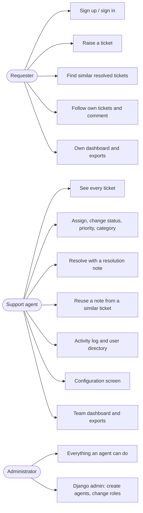

| Screen | Requester | Agent |
|---|:---:|:---:|
| Dashboard | own numbers | whole queue |
| My tickets / All tickets | own tickets only | every ticket |
| New ticket | ✅ | ✅ |
| Ticket detail | own tickets, read + comment | any ticket, full *Manage ticket* panel |
| Activity log, Users, Configuration | hidden (blocked by `agentGuard` and by the API) | ✅ |

---

## 2. End-to-end ticket workflow

The main path from a reported problem to a resolution, across both roles.

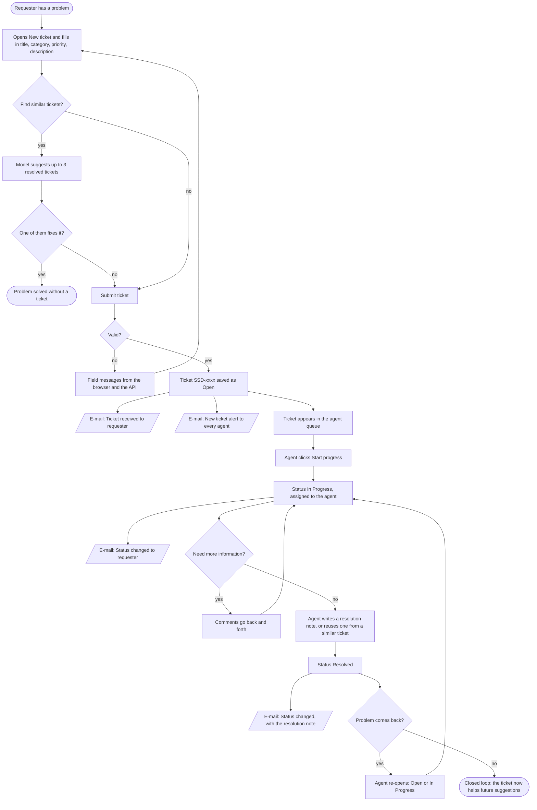

Every step that changes a ticket writes a row to `tickets_ticketactivity`, which is the ticket's timeline and the
*Activity log* screen.

---

## 3. Ticket status lifecycle

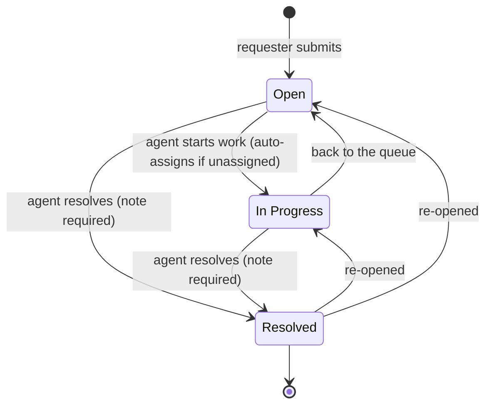

| Move | Who | Rule | Activity rows | E-mail |
|---|---|---|---|---|
| Submit | anyone signed in | title 5-150, description 20-5000 characters, active category | `created` | *Ticket received* to the requester, *New ticket alert* to agents |
| Open → In Progress | agent | if nobody has the ticket, it is assigned to the agent who moved it | `status_changed` (+ `assigned`) | *Status changed* to the requester |
| → Resolved | agent | resolution note of at least 10 characters | `status_changed` with the note | *Status changed* with the resolution note |
| Resolved → Open / In Progress | agent | `resolved_by` and `resolved_at` are cleared | `status_changed` | *Status changed* |
| In Progress → Open | agent | - | `status_changed` | *Status changed* |
| Edit the note of a resolved ticket | agent | - | `resolution_updated` | - |
| Change category or priority | agent | value must be active and of the right list | `details_updated` | *Ticket details changed* |
| Assign / re-assign | agent | assignee must be an active agent | `assigned` | *Ticket assigned* to the new assignee |

The allowed moves are `STATUS_TRANSITIONS` in `backend/apps/tickets/constants.py`. They are sent to the UI through
`GET /api/config/`, so the status menu only offers moves the API will accept. The rules themselves live in
`backend/apps/tickets/services.py`.

---

## 4. Signing in and restoring a session

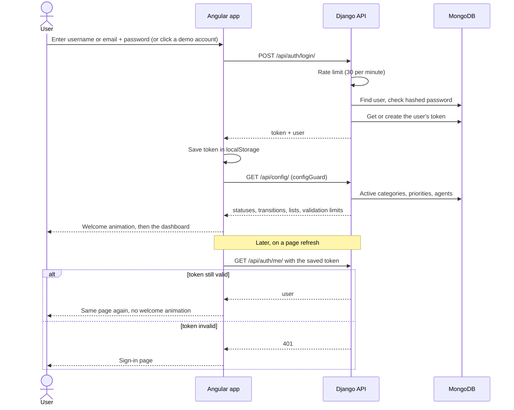

- Every later request carries `Authorization: Token <key>` (added by `core/interceptors/auth.interceptor.ts`).
- Any `401` from the API sends the user back to the sign-in page with the address they were on.
- **Sign out** calls `POST /api/auth/logout/`, which deletes the token on the server.
- **Sign up** (`POST /api/auth/register/`) validates the password with Django's password rules and creates a
  requester, then signs them in the same way.

---

## 5. Raising a ticket (with similar ticket suggestions)

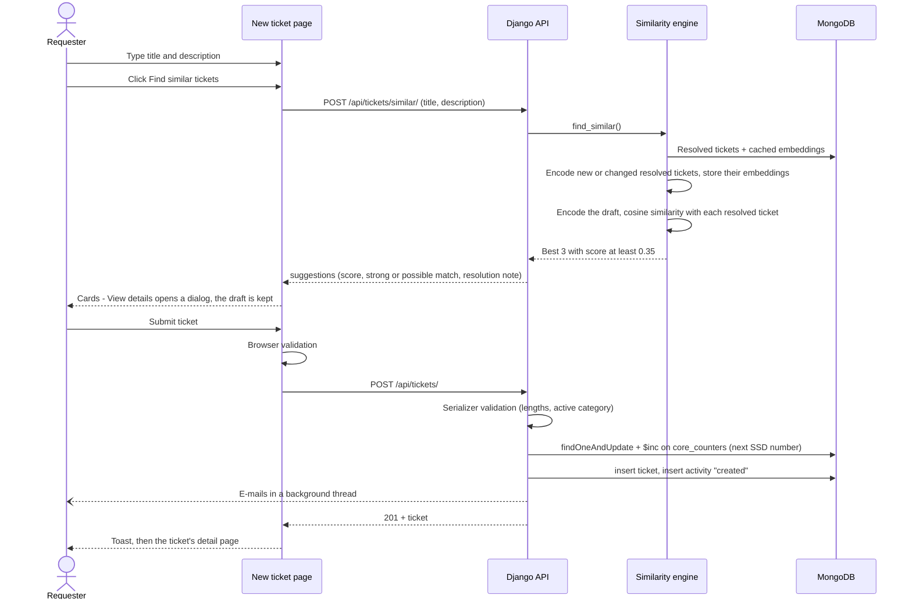

- Suggestions are advisory. They never change or close anything, and the ticket can always be submitted.
- If the model cannot be loaded, the same endpoint falls back to TF-IDF keyword matching and the panel says so.
- If validation fails the API answers `400` with `{"message": ..., "errors": {"field": [...]}}` and the message is
  shown under the matching form field.

---

## 6. Working and resolving a ticket

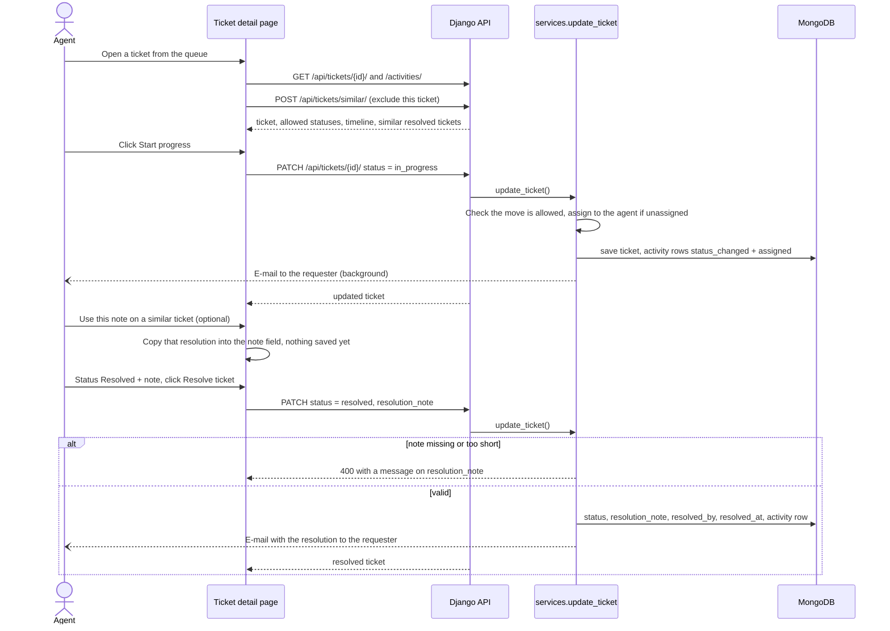

A resolved ticket is immediately available to the similar ticket suggestions: its embedding is computed on the
next search and cached.

---

## 7. Comments

Both sides can comment on a ticket they can see, at any status (a requester can reply on a resolved ticket if the
problem comes back).

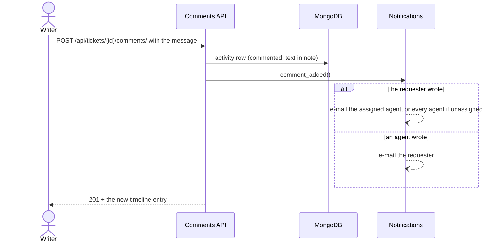

---

## 8. E-mail notifications

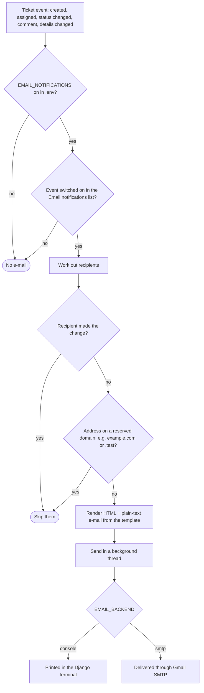

| Event (`notification_event` value) | Recipients |
|---|---|
| `ticket_received` | the requester |
| `new_ticket_alert` | every active agent |
| `ticket_assigned` | the new assignee (not when agents assign themselves) |
| `status_changed` | the requester, with the resolution note when resolved |
| `comment_added` | the requester when an agent comments; the assignee (or every agent if unassigned) when the requester comments |
| `details_updated` | the requester when the category or priority changes |

A mail server problem is logged and never breaks the request.

---

## 9. Exports: PDF, Excel and e-mail

Every table (tickets, activity log, users, configuration values) has an **Export** menu. The backend builds the
file from the same queryset as the table, so the export always matches what is on screen and respects the role.

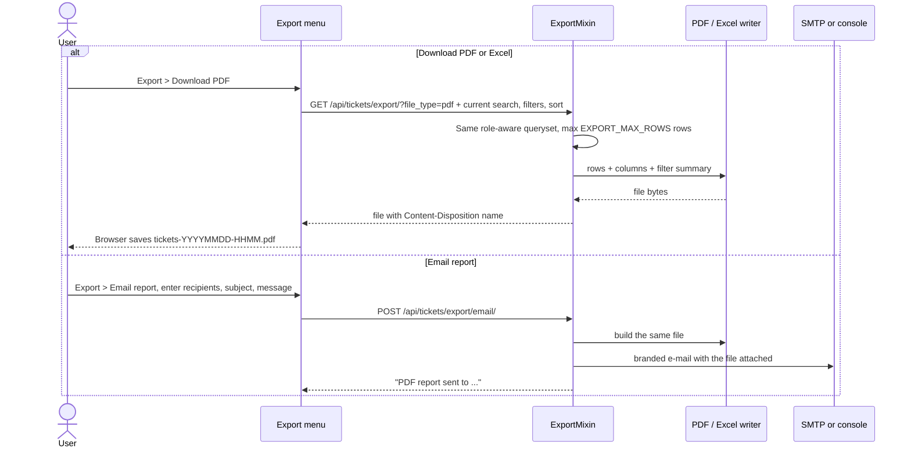

---

## 10. Configuration changes

Nothing selectable is hard-coded in Angular. An agent changes a list on the Configuration screen and every form,
filter and badge picks it up.

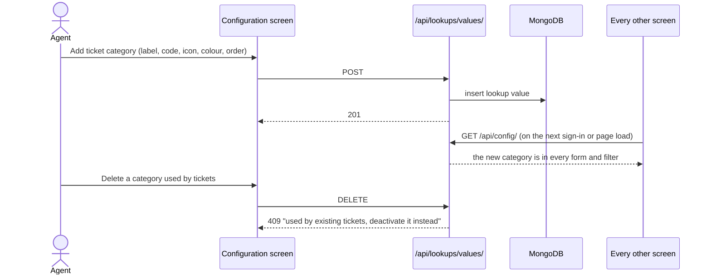

| Change | Effect |
|---|---|
| Deactivate a value | hidden from new tickets and filters; old tickets keep showing it |
| Mark a priority as default | pre-selected on the New ticket form and used by the API when no priority is sent; the previous default is cleared |
| Switch off an e-mail notification | that event stops sending e-mails at once |
| Delete a value in use | refused with `409 Conflict` |
| Delete or add a notification event | refused: they are built in and can only be renamed or switched off |

---

## 11. Inside one API request

What happens in Django for `PATCH /api/tickets/{id}/`, the same for every endpoint.

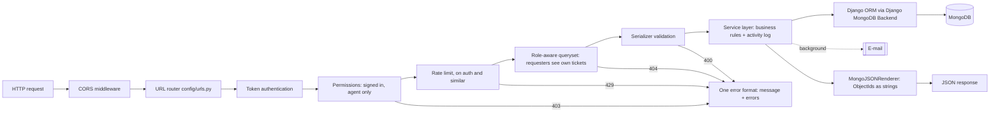

---

## 12. Continuous integration

`.github/workflows/ci.yml` runs on every push to `main`, on pull requests and on demand. A newer push to the same
branch cancels the run in progress.

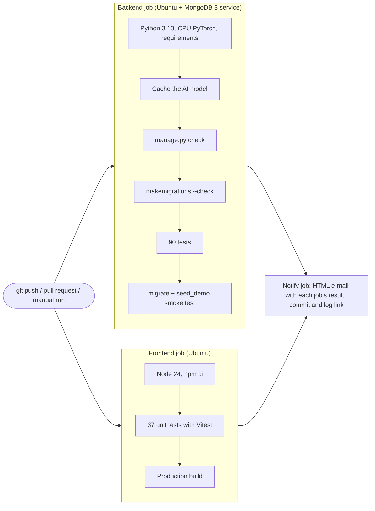

The notify job runs whether the tests passed or failed. If the `MAIL_USERNAME` / `MAIL_PASSWORD` repository secrets
are missing it only prints a notice, so the pipeline stays green.
